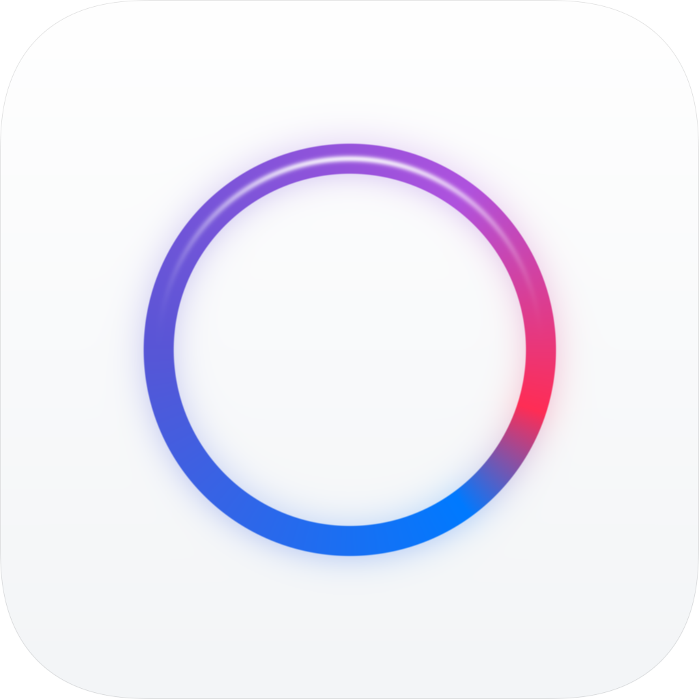

# AuraLyrics

<p align="center">
  
</p>

<p align="center">
  <b>English</b> | <a href="README.zh-TW.md">繁體中文</a>
</p>

> A dynamic lyrics application designed for iOS, supporting Apple Music tracking, Picture-in-Picture (PiP) floating window, and Dynamic Island Live Activities.
>>The vast majority of content in this repository was created by AI agents.

---

## Features

### 1. In-App Lyrics Interface
- **Apple Music Style Visuals**: Focuses on the currently playing line with background lines softly defocused, complemented by an immersive dynamic mesh gradient backdrop.
- **Syllable-Level Dynamic Karaoke**: Supports NetEase Cloud Music (YRC/KRC), Musixmatch (Richsync), and LRCLIB (Enhanced LRC) syllable timelines with smooth character glow animations.
- **Bilingual Lyrics**: Merged display of original lyrics and translations, toggleable in real time.

### 2. Desktop & Cross-App Lyrics Display
- **Picture-in-Picture (PiP) Floating Window**: Displays continuously updating lyrics in a native `AVPictureInPictureController` window when the app moves to background or switches to other apps.
- **Multiple Floating Styles**: Supports "Dynamic Island Capsule", "Standard Two-Line Card (Original + Translation)", and "Minimal Single-Line" styles.
- **Dynamic Island & Live Activity**: Supports the Lock Screen and iPhone Dynamic Island (compact & expanded modes) for rapid glance at current lyrics (requires Widget support).

### 3. Multi-Source Integration & Customization
- **Customizable Search Priority**: Integrates NetEase Cloud Music, Musixmatch, and LRCLIB. Freely adjust search order and independently toggle specific providers or word-sync/line-sync modes.
- **Manual Search & Timeline Calibration**: Search online and switch lyrics versions on the fly; manual offset adjustment (±0.1s) per song with persistent saving.
- **Local Cache & Custom Import**: Offline caching with support for manually importing local `.lrc` files.

### 4. Pure Client Architecture & Smart Background Keep-Alive
- **Pure Client Architecture**: Connects directly to system `MPMusicPlayerController` locally without requiring API keys or backend servers.
- **Smart Background Keep-Alive (`BackgroundKeepAliveManager`)**:
  - **Live Activity Mode**: Low-power location tracking combined with standard `BGTaskScheduler` intervals ensures background persistence without triggering media playback blocks.
  - **PiP Mode**: Compliant low-volume audio mixing keep-alive (zero non-public APIs) keeps the floating window active and updating smoothly.
  - **Termination Cleanup & Permission Consistency**: Concurrency-safe termination cleanup with unified permission descriptions (`InfoPlist.xcstrings`).

---

## Runtime Compatibility

AuraLyrics includes runtime environment detection (`RuntimeEnvironmentDetector`) and is distributed as a unified package **`AuraLyrics-<version>.ipa`**:

| Environment / Sideloading Tool | Dynamic Island / Lock Screen (`ActivityKit`) | Picture-in-Picture (`PiP`) | Description | Recommended Package |
| :--- | :---: | :---: | :--- | :--- |
| **LiveContainer** | ❌ (Guest apps do not support Extensions) | ✅ Supported | Automatically bypasses Extension calls and uses main app PiP engine | `AuraLyrics-0.1.0.ipa` |
| **SideStore / AltStore** | ✅ Supported (requires signing Extension Target) | ✅ Supported | Independent sideloaded environment supporting both Dynamic Island and PiP | `AuraLyrics-0.1.0.ipa` |
| **Personal Apple ID Sideload** | ⚠️ (Depends on signing tool's Extension support) | ✅ Supported | Standard PiP and background keep-alive available | `AuraLyrics-0.1.0.ipa` |

---

## 🛠️ Build & Packaging Guide

The project uses **XcodeGen (`project.yml`)** and **GitHub Actions** CI workflows to generate the `.ipa` package in the cloud or locally.

### Method A: Build via GitHub Actions (Recommended, no local Mac needed)
1. Push this project to your GitHub repository:
   ```bash
   git init
   git add .
   git commit -m "[feat]: initial commit for AuraLyrics"
   git remote add origin https://github.com/<your-username>/AuraLyrics.git
   git push -u origin main
   ```
2. Navigate to the **Actions** tab in your GitHub repository.
3. Trigger or wait for the `Build AuraLyrics IPA` workflow to complete.
4. Download `AuraLyrics-IPA.zip` from the workflow run artifacts.

### Method B: Build Locally on macOS with Xcode
```bash
# Install xcodegen (if not already installed)
brew install xcodegen

# Generate Xcode project
xcodegen generate

# Open project in Xcode for debugging or signing
open AuraLyrics.xcodeproj
```

---

## Installation & Usage Guide

### Using with LiveContainer
1. Download `AuraLyrics-0.1.0.ipa`.
2. Open **LiveContainer** on your iPhone and import the IPA.
3. In LiveContainer settings, ensure "Fix Background Audio" or background audio execution is enabled.
4. Launch AuraLyrics; the app automatically detects the environment and enables PiP floating mode.

### Using with Sideloading Tools (SideStore / AltStore / TrollStore / Feather, etc.)
1. Install `AuraLyrics-0.1.0.ipa` using your preferred sideloading tool.
2. Launch the app and grant the required "Media & Apple Music" permissions.
3. While playing music, view lyrics via **Dynamic Island / Lock Screen Live Activity** or the **PiP Floating Window**.

---

## Project Structure

```text
├── .github/workflows/
│   └── build-ipa.yml             # GitHub Actions automated IPA build workflow
├── AuraLyrics/
│   ├── AuraLyricsApp.swift       # SwiftUI app entry point
│   ├── Info.plist                # App permissions, Background Modes, LiveActivities
│   ├── Resources/
│   │   ├── InfoPlist.xcstrings   # Permission descriptions localization
│   │   └── AppIcon-Preview.png   # iOS Squircle app icon preview
│   ├── Services/
│   │   ├── AppleMusicMonitor.swift          # MPMusicPlayerController playback tracking
│   │   ├── ArtworkColorExtractor.swift      # Album artwork dominant color extraction
│   │   ├── BackgroundKeepAliveManager.swift # Smart background keep-alive manager
│   │   ├── LRCParser.swift                  # LRC parsing & syllable timeline processing
│   │   ├── LyricsProviderService.swift      # Multi-provider lyrics fetching & caching
│   │   └── RuntimeEnvironmentDetector.swift # Container & sideloading detection
│   ├── Engines/
│   │   ├── PiPLyricsEngine.swift            # AVPictureInPicture floating lyrics engine
│   │   └── LiveActivityLyricsEngine.swift   # ActivityKit Live Activity engine
│   └── Views/
│   ...
├── AuraLyricsWidget/
│   └── AuraLyricsLiveActivityWidget.swift   # Dynamic Island & Lock Screen widget
├── Shared/
│   └── ...                                  # Shared models and attributes
├── project.yml                              # XcodeGen project configuration
├── README.md                                # English documentation (default)
└── README.zh-TW.md                          # Traditional Chinese documentation
```

---

## Copyright & Disclaimer

- **Lyrics, Translations & Artwork**: All lyrics, translations, and album artwork displayed in this project belong to their respective songwriters, artists, publishers, and record labels.
- **Trademarks**: Apple Music and related trademarks are registered trademarks of Apple Inc.
- **Nature of Project**: AuraLyrics is a **non-commercial open-source utility** developed solely for personal learning, research, and display assistance. It contains no paid feature unlocks and is not authorized for commercial or monetized use.

---

## License

This project is licensed under the [MIT License](./LICENSE).
